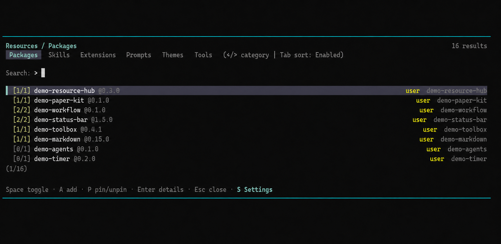

# pi-resource-center

[](https://www.npmjs.com/package/pi-resource-center)
[](https://github.com/sodie2323/pi-resource-center/releases)
[](./LICENSE)
[](https://github.com/sodie2323/pi-resource-center)

A keyboard-driven resource browser for [Pi](https://github.com/earendil-works/pi-mono): browse, enable/disable, and organize your **packages, skills, extensions, prompts, themes, tools, and MCP servers** from a single `/resource` TUI. Resource commands mirror browser actions; advanced server management uses native `/mcp`.

> Questions or bug reports? [Join the Discord](https://discord.com/channels/1456806362351669492/1489814646679666821).



## Quick start

```bash
pi install npm:pi-resource-center
```

Then in Pi:

```text
/reload
/resource
```

That's it. The browser opens on the **Packages** tab. Everything below is reference material.

## The Browser

### Categories

| Tab | What it shows | `Space` on a row |
|-----|---------------|------------------|
| **Packages** | Configured package sources with `[enabled/total]` contents summary | Enable/disable the whole package¹ |
| **Skills** | Project, user, and external (Claude/Codex/OpenCode) skills | Enable/disable |
| **Extensions** | Built-in, local, and package extensions | Enable/disable |
| **Prompts** | Prompt templates (with `argument-hint` in details) | Enable/disable |
| **Themes** | Built-in and custom themes | Apply theme |
| **Tools** | Registered tools (builtin + extensions + MCP), grouped by source/namespace | Toggle active set² |
| **MCP** | Server configuration, registered tools, and native resource-access entry points | Enable/disable server configuration; apply on `/reload` |

¹ Disabling a package replaces its resource filters with empty arrays; enabling restores the plain source. **Fine-grained `autoload`, glob, and `+/-/!` filters are cleared** — use **Browse Package Contents** in package details to preserve them. Resource Center refuses to disable its own running package.

² Core builtin tools and native `codemode` / `tool_search` changes also persist to Pi's `defaultTools`. Other tools only change the session/branch active set. Deactivating `codemode`/`deferred` tools does not block indirect calls (see [Tools](#tools)).

### Row badges

| Badge | Meaning |
|-------|---------|
| `[n/m]` | Group with `n` of `m` resources enabled (package rows, Codex plugin skills, tool sources) |
| `[pkg]` | Package-contained resource, shown in a top-level category |
| `[pin]` | Pinned to top of the list |
| `[override]` | Tool that replaces a builtin (e.g. an extension re-registering `read`) |
| `[session]` | Tool selection managed by the session/branch, not startup settings |
| `[codemode]` / `[deferred]` / `[model-only]` | Tool exposure; hidden tools are omitted |
| `[x]` / `[ ]` | Enabled/disabled; for MCP this is configuration state, **not** connection status |
| `[n tools]` | MCP tools currently registered and visible; not a server capability total |
| `[fetching tools…]` | Waiting for the first live inventory check; then shows the visible count, including `0 tools`. Disabled rows omit tool counts. |
| `[?]` / `[!]` | MCP configuration state unknown / configuration error |

### Keys

| Key | Browser list | Detail view | Add view | Settings (`Shift+S`) |
|-----|--------------|-------------|----------|----------------------|
| `←/→` | Switch category | — | — | Switch settings tab |
| `Tab` | Cycle sort mode³ | — | Switch scope | Switch settings tab |
| `↑/↓` | Move selection | Choose action | Pick suggestion | Move selection |
| `PgUp/PgDn` | Page through list | — | — | — |
| `j/k` | Type to filter | Scroll content down/up | Type | Type to filter |
| `o` | Type to filter | Expand/collapse a long Description | Type | Type to filter |
| `Enter` | Open details | Confirm action | Add | Change / edit inline |
| `Space` | Toggle item/group; MCP: enable/disable | — | — | Toggle integration |
| `A` | Add resource | Add resource | — | Add custom source⁴ |
| `P` | Pin/unpin | Pin/unpin | — | — |
| `M` | Open native `/mcp` (MCP tab only) | — | — | — |
| `R` | — | — | — | Remove custom source⁴ |
| `Type` | Filter list | — | Enter source | Filter settings |
| `Esc` | Close | Back | Back | Close / cancel |
| `Shift+S` | Settings | Settings | — | — |

³ Sort modes: `Recent`, `Default`, `Name`, `Enabled`, `Scope`.
⁴ Integrations tab only.

Notes:

- **Browse Package Contents** in package details opens one flat, searchable list of contained extensions, skills, prompts, and themes. All resources use the normal list-row layout; the right column identifies type rather than repeating the package source. There are no category preview limits or “more” entries. Search, sort, pin, toggle and detail navigation work across types, with selection preserved on return and inventory updates. Package-contained resources can be surfaced in their top-level category via **Show in Category** (marked `[pkg]`).
- **Add view**: default scope follows the current selection context; inline suggestions for local paths, `npm:`, `git:`, and GitHub URLs. Remote adds run the real Pi install before writing settings. Long operations show a live status widget and survive leaving the view.
- **Descriptions** initially show at most four wrapped lines. Long descriptions have an inline `o expand` / `o collapse` hint (compact `o +` / `o −` in narrow windows); no extra action is added. Scrollable content has one shared `j/k` hint, with argument counts kept beside Parameters and body-line counters omitted. Narrow headers drop statistics/context before resource names, and action labels wrap before auxiliary hints are shortened or omitted.
- **Tool details** show top-level arguments as compact, description-first rows with code-colored names, secondary explanations, type coloring, and subdued scalar defaults; `*` marks required arguments. At most four arguments are displayed at once; `j/k` slides the window through the remaining arguments without opening another page. Narrow windows put descriptions below the argument name/type. When both the content area and argument window overflow, `j` reaches the end of the content before advancing arguments; `k` restores earlier arguments before scrolling the content upward. Full JSON schemas and nested object fields are not displayed.
- **Prompt details** preview the first six wrapped body lines, without frontmatter or argument expansion. Truncated previews are marked `…`, and descriptions repeated at the start of the body are not shown twice. Long tool/prompt content scrolls with `j` (down) / `k` (up), also accepting uppercase `J/K`, while actions stay visible. Arrow keys still select actions; details do not bind `PgUp/PgDn`.
- **Settings view** persists preferences (sort mode, reload behavior, search options, pins, external skill sources) to [its own file](#plugin-settings).

## Behavior notes

### Tools

The Tools tab reads Pi's `getAllTools()` / `getActiveTools()` inventories on open and automatically checks for changes every second while the browser remains open. Tools from the same source or namespace are grouped (`builtin`, package name, `local:<file>`, or `mcp:<server>`); single-tool sources are plain rows. The builtin group always sorts first.

- **Builtin tools** (read, bash, powershell, edit, write, grep, find, ls, plus native codemode and tool_search): toggles update the active set **and** persist only the requested `+name`/`-name` change to Pi's `defaultTools` — project settings if the trusted project defines `defaultTools`, otherwise user settings. Unrelated entries, inheritance, and explicit empty allowlists are preserved.
- **Other extension/SDK/MCP tools**: change the session/branch active set, not startup settings. Pi may restore that selection on resume, but `/reload` can reactivate tools registered active by default. Resource Center does not save and restore these selections across reloads. Disable the providing package/extension or use native `/mcp` for persistent server configuration.
- **Exposure matters**: `codemode` and `deferred` tools remain callable through codemode/tool search even when inactive; their actions are Activate/Deactivate, not access controls. Withdrawn `hidden` tools are omitted. With `codemode.mode: "only"`, active tools may also be hidden from direct model declarations.
- Tool selection does not unload the extension, its commands, or its event handlers and is not a permission boundary.
- Tools are runtime capabilities: no add/remove/update/pin, and they don't count toward package summaries.
- On Windows, enabling `powershell` and disabling `bash` persistently replaces Bash with PowerShell — equivalent to:

```json
{ "defaultTools": ["read", "powershell", "edit", "write"] }
```

### MCP

`/resource mcp` lists servers from user/trusted-project `mcp.json`, extension registrations, and observed MCP tool namespaces. Disabled servers remain visible. Project overrides are shown only after trust; configuration secrets, arguments, environment variables, and credentials are not displayed or executed.

- `Enter` opens server details; **Browse Tools** switches to its namespace in Tools without removing tools from that category. List rows use the same checkbox, pin, scope, and source layout as other resources; unknown/error states use `[?]` / `[!]`.
- `Space` or **Enable/Disable** updates the server's `enabled` flag in its effective user/project `mcp.json`, preserving transport, credentials, exposure overrides, and unrelated entries. The row reflects saved configuration, not live connection status. Changes apply on `/reload`, following Resource Center's reload preference when the browser closes.
- For extension registrations, Resource Center attempts the native registration API. Pi permits updates only to registrations owned by the calling extension; these requests are session-only and need no reload. Registrations owned by another extension cannot be taken over or silently copied into `mcp.json`; use native `/mcp` for those. Runtime-only servers without editable config also retain the native-manager fallback.
- `M` or **Open MCP Manager** closes Resource Center and dispatches the existing `/mcp` command for connection, authentication, and exposure management. Resource Center does not open additional connections.
- Pi 1.4 does not expose a per-server resource inventory or connection-status API to extension commands. Resources are explicitly **not queried**, not counted as zero. Details show the shared native `list_mcp_resources`, `list_mcp_resource_templates`, and `read_mcp_resource` tools when registered; their presence does not prove that a particular server offers resources.
- Tools and observed MCP namespaces update automatically while the browser is open, including late registrations and withdrawals. The lightweight check does not rescan files, synchronize skills, activate tools, or connect servers; unchanged inventories do not redraw. Selection, searches, expanded groups, and pins are preserved. Checks stop when the browser closes.
- Empty initial inventories show **fetching tools** until the first successful live check, then **0 tools** if none are listed. Counts track currently registered, visible tools and keep updating if tools arrive later; they are not connection status or a server capability total. Connection diagnostics remain in `/mcp`. File configuration is read on open and after configuration actions, not polled.
- `/resource enable mcp <name>` and `/resource disable mcp <name>` use the same toggle flow; adding/removing servers still uses native `pi mcp add/remove`.

### Themes

Themes are **applied**, not enabled/disabled: `Space` switches the UI immediately and saves the theme setting. Available themes come from Pi's runtime inventory, merged with discovered file/package metadata. Built-in `system` (Pi's default), `dark`, and `light` can't be removed; custom themes can. The name `system` is reserved.

### Discovery model

Resources are discovered from, in both project and user scope:

- Pi settings path entries (`extensions`, `skills`, `prompts`, `themes` arrays, including `+`/`-`/`!` and glob filters)
- Conventional folders: `.pi/extensions|skills|prompts|themes` and `~/.pi/agent/...`
- Pi's built-in extensions: `builtin:mcp`, `builtin:llama.cpp`, `builtin:codemode`, and `builtin:tool-search` (disable/enable, not remove)
- Agent Skills folders: `.agents/skills/` in the current directory and its ancestors
- Configured package sources (`npm:`, `git:`, `http(s)://`, local paths), including `autoload: false` deltas
- External skill sources configured in Resource Center settings (see [Integrations](#integrations))

By default, package-contained extensions/skills/prompts are managed from the package's **Browse Package Contents** view; **Show in Category** surfaces them top-level. Package themes are always shown in the Themes tab. When a project is not trusted, project-scope resources are neither discovered nor modified.

## Commands (Reference)

`Tab` completes resource subcommands and names. MCP enable/disable commands mirror the browser; advanced management uses native `/mcp` / `pi mcp`.

| Command | Purpose | Example |
|---------|---------|---------|
| `/resource [category]` | Open the browser | `/resource tools` |
| `/resource sync` | Re-run discovery | `/resource sync` |
| `/resource mcp` | Browse MCP server overview | `/resource mcp` |
| `/resource add [category] <src> [project\|user]` | Register a package or local resource | `/resource add npm:@scope/pkg user` |
| `/resource enable [category] <name>` | Enable | `/resource enable tool powershell` |
| `/resource disable [category] <name>` | Disable | `/resource disable package npm:@scope/pkg` |
| `/resource remove [category] <name>` | Remove from settings | `/resource remove theme my-theme` |
| `/resource expose [category] <name>` | Surface package resource top-level | `/resource expose prompt review.md` |
| `/resource hide [category] <name>` | Reverse of expose | `/resource hide skill review` |

Category aliases: `package`, `skill`, `extension`, `prompt`, `theme`, `tool` (plural forms work). Matching covers name, source, path, and package-relative path.

## Integrations

`Shift+S` → **Integrations** manages external skill sources: Claude, Codex, Codex Plugins, OpenCode, plus custom directories (add with `A`, remove with `R`, toggle with `Space`, edit paths inline).

- Enabled sources are synchronized into Pi's `settings.json` `skills` entries so Pi owns directory discovery.
- Codex plugin skills are grouped by plugin in the Skills browser and get **stable IDs** (`source + plugin + relative path`), so disabled skills stay disabled across Codex cache or version changes. Disabled state lives in Resource Center settings, not in Codex paths.
- The Codex Plugins integration only syncs plugins that don't declare `apps` (app-backed plugins may need Codex/OpenAI runtime Pi can't provide).

## Plugin settings

Resource Center stores its own state (preferences, pins, exposed resources, disabled external skill IDs, external sources, sync entries) in a separate file, not in Pi's `settings.json`:

- Windows: `C:\Users\<you>\.pi\agent\pi-resource-center-settings.json`
- macOS/Linux: `~/.pi/agent/pi-resource-center-settings.json`

Honors `PI_CODING_AGENT_DIR`. Stale pins/exposures are pruned automatically. Legacy `resource-hub.json` files are safe to delete.

## Requirements

- Node.js `>=22.19.0`, Pi `>=1.4.0`
- Peer dependencies: `@earendil-works/pi-coding-agent >=1.4.0`, `@earendil-works/pi-tui >=1.4.0`
- Development checks use exact Pi `1.4.0` dependencies: `npm ci --ignore-scripts` then `npm run check`.

<details>
<summary>Alternative install methods</summary>

```bash
# From GitHub
pi install https://github.com/sodie2323/pi-resource-center

# From a local path (loads the folder directly — run /reload after changes)
pi install .
pi install E:/code/pi-resource-center
```

</details>

## License

MIT
