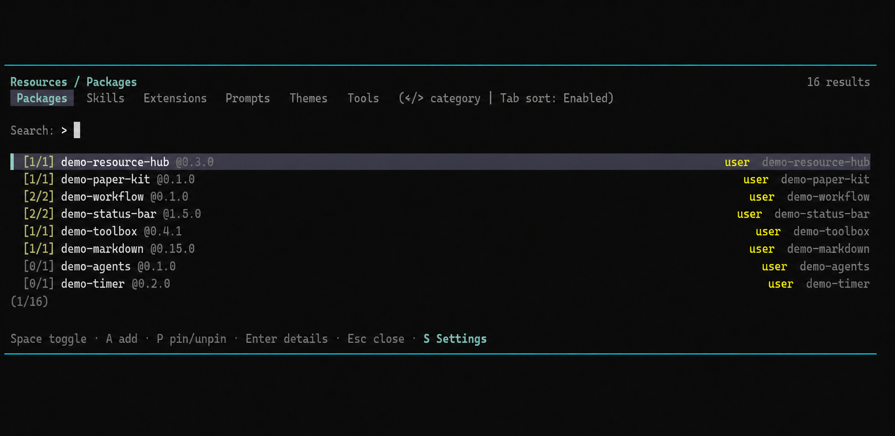

# pi-resource-center

[](https://www.npmjs.com/package/pi-resource-center)
[](https://github.com/sodie2323/pi-resource-center/releases)
[](./LICENSE)
[](https://github.com/sodie2323/pi-resource-center)

A keyboard-driven resource browser for [Pi](https://github.com/earendil-works/pi-mono): browse, enable/disable, and organize your **packages, skills, extensions, prompts, themes, and tools** from a single `/resource` TUI. Slash commands mirror every browser action.

> Questions or bug reports? [Join the Discord](https://discord.com/channels/1456806362351669492/1489814646679666821).



## Quick start

```bash
pi install npm:pi-resource-center
```

Then in Pi:

```text
/reload
/resource
```

That's it. The browser opens on the **Packages** tab. Everything below is reference material.

## The Browser

### Categories

| Tab | What it shows | `Space` on a row |
|-----|---------------|------------------|
| **Packages** | Configured package sources with `[enabled/total]` contents summary | Enable/disable the whole package¹ |
| **Skills** | Project, user, and external (Claude/Codex/OpenCode) skills | Enable/disable |
| **Extensions** | Local and package extensions | Enable/disable |
| **Prompts** | Prompt templates (with `argument-hint` in details) | Enable/disable |
| **Themes** | Built-in and custom themes | Apply theme |
| **Tools** | Registered tools (builtin + extensions), grouped by source | Enable/disable² |

¹ Disabling a package replaces its resource filters with empty arrays; enabling restores the plain source. **Fine-grained `autoload`, glob, and `+/-/!` filters are cleared** — use **Manage Resources** (`Enter` on the package) to preserve them. Resource Center refuses to disable its own running package.

² Builtin tool changes also persist to Pi's native `defaultTools`; extension tool changes are session-only (see [Tools](#tools)).

### Row badges

| Badge | Meaning |
|-------|---------|
| `[n/m]` | Group with `n` of `m` resources enabled (package rows, Codex plugin skills, tool sources) |
| `[pkg]` | Package-contained resource, shown in a top-level category |
| `[pin]` | Pinned to top of the list |
| `[override]` | Tool that replaces a builtin (e.g. an extension re-registering `read`) |
| `[session]` | Tool whose on/off state is session-only |

### Keys

| Key | Browser list | Detail view | Add view | Settings (`Shift+S`) |
|-----|--------------|-------------|----------|----------------------|
| `←/→` | Switch category | — | — | Switch settings tab |
| `Tab` | Cycle sort mode³ | — | Switch scope | Switch settings tab |
| `↑/↓` | Move selection | Choose action | Pick suggestion | Move selection |
| `PgUp/PgDn` | Page through list | — | — | — |
| `Enter` | Open details | Confirm action | Add | Change / edit inline |
| `Space` | Toggle item / expand group | — | — | Toggle integration |
| `A` | Add resource | Add resource | — | Add custom source⁴ |
| `P` | Pin/unpin | Pin/unpin | — | — |
| `R` | — | — | — | Remove custom source⁴ |
| `Type` | Filter list | — | Enter source | Filter settings |
| `Esc` | Close | Back | Back | Close / cancel |
| `Shift+S` | Settings | Settings | — | — |

³ Sort modes: `Recent`, `Default`, `Name`, `Enabled`, `Scope`.
⁴ Integrations tab only.

Notes:

- **Manage Resources** (`Enter` on a package) opens the package contents view to browse and toggle contained extensions, skills, prompts, and themes individually. Package-contained resources can be surfaced in their top-level category via **Show in Category** (marked `[pkg]`).
- **Add view**: default scope follows the current selection context; inline suggestions for local paths, `npm:`, `git:`, and GitHub URLs. Remote adds run the real Pi install before writing settings. Long operations show a live status widget and survive leaving the view.
- **Settings view** persists preferences (sort mode, reload behavior, search options, pins, external skill sources) to [its own file](#plugin-settings).

## Behavior notes

### Tools

The Tools tab reads Pi's live `getAllTools()` / `getActiveTools()` inventories. Tools from the same source are grouped (`builtin`, package name, or `local:<file>`); single-tool sources are plain rows. The builtin group always sorts first.

- **Builtin tools** (read, bash, powershell, edit, write, grep, find, ls): toggles apply immediately **and** persist to Pi's `defaultTools` — project settings if the trusted project defines `defaultTools`, otherwise user settings.
- **Extension/SDK tools**: session-only, because Pi has no persistent per-tool setting for custom tools. To remove them permanently, disable their package or extension instead.
- Disabling a tool only stops the model calling it; it does not unload the extension, its commands, or its event handlers.
- Tools are runtime capabilities: no add/remove/update/pin, and they don't count toward package summaries.
- On Windows, enabling `powershell` and disabling `bash` persistently replaces Bash with PowerShell — equivalent to:

```json
{ "defaultTools": ["read", "powershell", "edit", "write"] }
```

### Themes

Themes are **applied**, not enabled/disabled: `Space` switches the UI immediately and saves the theme setting. Built-in `dark`/`light` can't be removed; custom themes can.

### Discovery model

Resources are discovered from, in both project and user scope:

- Pi settings path entries (`extensions`, `skills`, `prompts`, `themes` arrays, including `+`/`-`/`!` and glob filters)
- Conventional folders: `.pi/extensions|skills|prompts|themes` and `~/.pi/agent/...`
- Agent Skills folders: `.agents/skills/` in the current directory and its ancestors
- Configured package sources (`npm:`, `git:`, `http(s)://`, local paths), including `autoload: false` deltas
- External skill sources configured in Resource Center settings (see [Integrations](#integrations))

By default, package-contained extensions/skills/prompts are managed from the package's **Manage Resources** view; **Show in Category** surfaces them top-level. Package themes are always shown in the Themes tab. When a project is not trusted, project-scope resources are neither discovered nor modified.

## Commands (Reference)

Every browser action is also a command. `Tab` completes subcommands and resource names.

| Command | Purpose | Example |
|---------|---------|---------|
| `/resource [category]` | Open the browser | `/resource tools` |
| `/resource sync` | Re-run discovery | `/resource sync` |
| `/resource add [category] <src> [project\|user]` | Register a package or local resource | `/resource add npm:@scope/pkg user` |
| `/resource enable [category] <name>` | Enable | `/resource enable tool powershell` |
| `/resource disable [category] <name>` | Disable | `/resource disable package npm:@scope/pkg` |
| `/resource remove [category] <name>` | Remove from settings | `/resource remove theme my-theme` |
| `/resource expose [category] <name>` | Surface package resource top-level | `/resource expose prompt review.md` |
| `/resource hide [category] <name>` | Reverse of expose | `/resource hide skill review` |

Category aliases: `package`, `skill`, `extension`, `prompt`, `theme`, `tool` (plural forms work). Matching covers name, source, path, and package-relative path.

## Integrations

`Shift+S` → **Integrations** manages external skill sources: Claude, Codex, Codex Plugins, OpenCode, plus custom directories (add with `A`, remove with `R`, toggle with `Space`, edit paths inline).

- Enabled sources are synchronized into Pi's `settings.json` `skills` entries so Pi owns directory discovery.
- Codex plugin skills are grouped by plugin in the Skills browser and get **stable IDs** (`source + plugin + relative path`), so disabled skills stay disabled across Codex cache or version changes. Disabled state lives in Resource Center settings, not in Codex paths.
- The Codex Plugins integration only syncs plugins that don't declare `apps` (app-backed plugins may need Codex/OpenAI runtime Pi can't provide).

## Plugin settings

Resource Center stores its own state (preferences, pins, exposed resources, disabled external skill IDs, external sources, sync entries) in a separate file, not in Pi's `settings.json`:

- Windows: `C:\Users\<you>\.pi\agent\pi-resource-center-settings.json`
- macOS/Linux: `~/.pi/agent/pi-resource-center-settings.json`

Honors `PI_CODING_AGENT_DIR`. Stale pins/exposures are pruned automatically. Legacy `resource-hub.json` files are safe to delete.

## Requirements

- Node.js `>=22.19.0`, Pi `>=0.79.7`
- Peer dependencies: `@earendil-works/pi-coding-agent >=0.79.7`, `@earendil-works/pi-tui >=0.79.7`

<details>
<summary>Alternative install methods</summary>

```bash
# From GitHub
pi install https://github.com/sodie2323/pi-resource-center

# From a local path (loads the folder directly — run /reload after changes)
pi install .
pi install E:/code/pi-resource-center
```

</details>

## License

MIT
